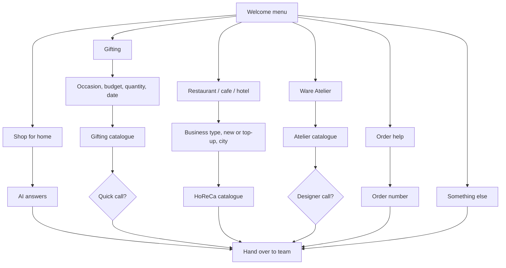

# WhatsApp workflow (Gallabox)

A basic flow for the Ware WhatsApp number: a welcome menu, one branch per
kind of customer, and a handover to the right person at the end of each.
The AI agent (with the knowledge base doc) answers free-typed questions at
any point; this workflow handles the structured parts.

WhatsApp limits to keep in mind when building it:

- Reply buttons: max 3 per message, 20 characters each.
- List messages: max 10 rows, row titles 24 characters.
- Text questions: save the answer to a contact field (attribute) so the
  team sees it on handover.

## Overview

## 1. Welcome

**Trigger:** first message from a new contact, or a keyword like "hi",
"hello", "menu".

**Message (list):**

> Hi, welcome to Ware Innovations! What can we help you with today?

| Row | Goes to |
| --- | --- |
| Shop for my home | 2. Retail |
| Gifting | 3. Gifting |
| Restaurant, cafe, hotel | 4. HoReCa |
| Ware Atelier (bespoke) | 5. Atelier |
| Help with an order | 6. Order help |
| Something else | 7. Others |

Set attribute `enquiry_type` from the row picked.

## 2. Retail (shop for home)

**Message (list):**

> Lovely! What would you like to know?

| Row | Then |
| --- | --- |
| Find a piece | Ask "What are you looking for? A piece, a colour, a budget, anything helps." → AI agent answers |
| Delivery and shipping | Ask for their pincode → AI agent answers (free shipping on Rs 5,000+, dispatch in 24 to 48 hours, usually 6 to 7 working days) |
| Returns and exchanges | Send: 14 days from delivery, unused, original packaging, free pickup. Start here: https://www.wareinnovations.com/apps/return_prime |
| Visit our store | Send address, hours (Mon to Sat, 10:30 am to 7 pm) and map: https://maps.app.goo.gl/xvfFKjgKcb9agCtc6 |
| Talk to us | Handover (support) |

**Wants to order or asks for a payment link:** ask for the products,
quantities and city, then hand over to sales. Never ask for payment details.

**Discounts:** only the 5% first-order offer on ceramics (not marble,
Collectibles or Atelier).

## 3. Gifting

Details first, catalogue after.

**Step 1: occasion (list).**

> We'd love to help with your gifting! What's the occasion?

Rows: Festive (Diwali etc.) · Corporate / clients · Wedding · Other occasion.
Save as `gift_occasion`.

**Step 2: budget per gift (list).**

Rows: Under Rs 1,000 · Rs 1,000 to 2,000 · Rs 2,000 to 3,500 ·
Above Rs 3,500. Save as `gift_budget`.

**Step 3: how many (list).**

Rows: Under 20 · 20 to 99 · 100 to 199 · 200 or more. Save as `gift_qty`.

**Step 4: date (text).**

> And when do you need them by?

Save as `gift_date`.

**Step 5: catalogue and the right service.**

> Thank you! Here's our gifting catalogue: https://cdn.shopify.com/s/files/1/0039/8498/2051/files/Ware_Gift_Studio_Catalog.pdf?v=1791870937

Then one line by quantity:

| Quantity | Line to add |
| --- | --- |
| Under 100 | Our Quick Gifting sets ship from ready stock in about 36 hours, with a ribbon and personalised note. |
| 100 to 199 | You could also add your logo to the box with Branded Gifting (Rs 15,000 + GST, about 25 days). |
| 200 or more | You could also build a fully custom set and box with Build Your Own (Rs 24,000 + GST, 25+ days). |

If the date is less than 25 days away and they're at 100+, add: "For
branding, we'd need about 25 days, so ready-stock sets suit your date best."

**Step 6: call (buttons).**

> Could our team give you a quick call to take this forward?

Buttons: Yes, call me · Not now.

- Yes → ask name (text) and a good time to call (text) → handover to
  **Priyal (gifting)** with all the `gift_*` fields.
- Not now → "No problem! Ask us anything here, we're happy to help." → AI
  agent.

Over 20 pieces: the bot never confirms stock or dates; Priyal confirms.

## 4. HoReCa (restaurant, cafe, hotel)

**Step 1: business type (list).** Restaurant · Cafe · Hotel · Caterer /
cloud kitchen. Save as `horeca_type`.

**Step 2: buttons.** New outlet · Restocking · Just exploring. Save as
`horeca_stage`.

**Step 3: city (text).** Save as `city`.

**Step 4: catalogue and plan.**

> Here's our HoReCa catalogue: https://cdn.shopify.com/s/files/1/0039/8498/2051/files/Ware_HORECA_Catalog_2026_30th_Sept.pdf?v=1790746449
>
> With our HoReCa plan (Rs 5,000 a year) you get up to 35% off all ceramic ware, from just 24 pieces per product.

**Step 5: buttons.** Get a quote · Order samples · Ask a question.

- Get a quote / Order samples → ask which pieces and roughly how many
  (text) → handover to **sales / HoReCa team**.
- Ask a question → AI agent.

## 5. Ware Atelier (bespoke)

**Step 1: catalogue.**

> Ware Atelier pieces are bespoke marble furniture and lighting, made to order for each client. Here's the catalogue: https://cdn.shopify.com/s/files/1/0039/8498/2051/files/Ware_Atelier_Bespoke_Furniture_Catalog.pdf?v=1790597905

**Step 2: buttons.**

> Would you like one of our designers to give you a call?

Buttons: Yes, call me · Not now.

- Yes → ask name, email, and a short brief (piece, material, quantity,
  timeline) → handover to **Ware Atelier team**.
- Not now → "You can also reach Ware Atelier directly on +91 96196 20099."

Never quote a price or lead time for bespoke pieces in the bot. The
Collectibles (marble vases, tissue boxes) are priced on the website and
go through Retail.

## 6. Order help

**Step 1 (list).** Where's my order · Damaged or wrong item · Cancel or
change · Payment or COD · Something else.

**Step 2.** Ask for the order number or the mobile number used to order
(text). Save as `order_ref`.

| Row | Then |
| --- | --- |
| Where's my order | "Tracking details are emailed once it's dispatched. Let us check for you." → handover (support) |
| Damaged or wrong item | Ask for a photo or video → "So sorry! We'll replace it free." → handover (support) |
| Cancel or change | "Changes are possible until it's packed and dispatched." → handover (support) |
| Payment or COD | Send: UPI, net banking, PhonePe, cards; COD up to Rs 50,000 → AI agent |
| Something else | handover (support) |

## 7. Others

**Step 1 (list).** Stock Ware in my shop · Collaboration or press ·
Something else.

- Stock Ware in my shop → "Please share your business profile and our
  sales head will reach out, or email hello@wareinnovations.com." →
  handover (sales).
- Collaboration or press → "Please email hello@wareinnovations.com with
  the details." → end.
- Something else → "Tell us what you need and we'll help." → AI agent.

## Everywhere

- **"Talk to a person"** at any point → handover straight away.
- **Outside team hours** (Mon to Sat, 10 am to 7 pm): before a handover,
  send "Thanks! Our team is around Monday to Saturday, 10 am to 7 pm, and
  will pick this up then."
- **"menu"** brings back the welcome list.
- **Voice:** "we", "us", "our team", never "they". Short and warm.

## Handover summary

| Branch | Assign to | Fields the team sees |
| --- | --- | --- |
| Gifting | Priyal | occasion, budget, quantity, date, name, time to call |
| HoReCa | Sales / HoReCa team | type, stage, city, pieces and quantities |
| Atelier | Ware Atelier team | name, email, brief |
| Retail order / payment link | Sales | products, quantities, city |
| Order help | Support | order number, issue, photo |
| Reselling | Sales | business profile |

Open: who handles Support, Sales and HoReCa in Gallabox (names or teams).
